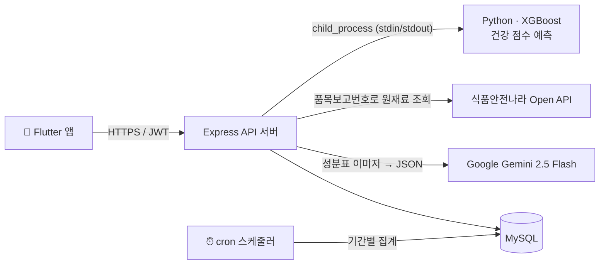
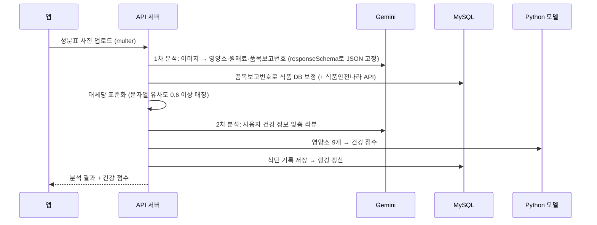
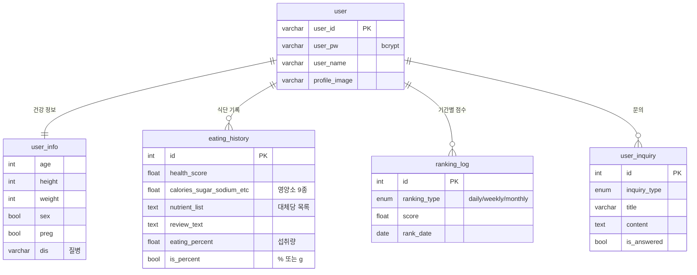

# 찾았당 (Chazadang) — Backend API

> 식품 **영양성분표 사진 한 장**으로 영양 점수와 대체당(인공 감미료) 정보를 알려주는 건강 관리 앱 **「찾았당」**의 REST API 서버입니다.


-3776AB?logo=python&logoColor=white)


| 구분 | 내용 |
|---|---|
| 형태 | 팀 프로젝트 (Flutter 앱 + Node.js 백엔드) |
| 기간 | 2025.07 ~ 2025.09 (포트폴리오 정리 2026.10) |
| 본인 역할 | 백엔드 — 프로젝트 초기 구조, **랭킹 집계 시스템**, **1:1 문의 API**, DB 스키마 확장 ([상세](#-내-담당)) |
| 프론트엔드 | Flutter 앱 (팀원 담당, 비공개 저장소) |

<!-- 📸 데모: 앱 화면 GIF 또는 스크린샷을 여기에 추가하세요. 예)  -->

---

## 📌 어떤 서비스인가요?

제로·저당 제품의 성분표에는 아스파탐, 수크랄로스 같은 대체당과 여러 영양 수치가 적혀 있지만, 일반 소비자가 바로 해석하기는 어렵습니다.
찾았당은 사용자가 **성분표를 촬영하면** 다음을 한 번에 제공합니다.

1. **영양 성분 자동 추출** — Gemini가 사진에서 열량·당류·나트륨 등 9개 영양소와 원재료를 읽어 JSON으로 구조화
2. **건강 점수 예측** — 영양소 9개를 입력으로 XGBoost 회귀 모델이 건강 점수 산출
3. **대체당 분석 · 맞춤 리뷰** — 원재료에서 대체당을 찾아 표준 이름으로 정리하고, 사용자의 나이·질병·임신 여부를 반영한 리뷰 생성
4. **기록 · 랭킹** — 먹은 제품을 캘린더에 기록하고, 평균 건강 점수로 일간·주간·월간 랭킹 제공

## 🏗 시스템 구조



### 사진 분석 요청 흐름 (`POST /api/eating-history/product-image`)



## 🧩 주요 기능 (API)

전체 요청·응답 예시는 **[docs/API.md](docs/API.md)** 에 있습니다.

| 도메인 | 엔드포인트 | 설명 |
|---|---|---|
| 인증 | `POST /api/auth/register` · `login` · `check-id` | 회원가입(건강 정보 포함), 로그인(JWT 발급), 아이디 중복 확인 |
| 사용자 | `GET/PUT/DELETE /api/users/me…` | 프로필 조회·수정, 프로필 이미지, 오늘 섭취 요약, 회원 탈퇴 |
| 식단 분석 | `POST /api/eating-history/product-image` | 성분표 사진 분석 → 점수·리뷰 생성 후 저장 |
| 식단 기록 | `GET/PATCH/DELETE /api/eating-history/:id`, `recent` | 최근 기록, 상세, 섭취량(% 또는 g) 수정, 삭제 |
| 캘린더 | `GET /api/calendar/status`, `POST /api/calendar/date` | 월별 기록 있는 날짜, 날짜별 기록 |
| 랭킹 | `GET /api/rankings?period=daily\|weekly\|monthly` | 기간별 평균 건강 점수 TOP 10 + 내 순위 |
| 1:1 문의 | `POST/GET/PATCH/DELETE /api/inquiry…` | 문의 작성·목록(유형 필터, 페이지네이션)·상세·수정·삭제 |

## 🗂 데이터 모델



전체 DDL: [`db/schema.sql`](db/schema.sql)

## 🙋 내 담당

> 팀 백엔드에서 아래 부분을 맡았습니다. (커밋 기록: `JWI112`, `정원일`)

**1. 프로젝트 초기 구조 · DB 연결 (2025.07)**
- 저장소 생성, Express 폴더 구조(routes / controllers / services) 구성
- MySQL 연결 설정, `.env` 분리와 `.gitignore` 설정

**2. 랭킹 집계 시스템** — `services/rankingUpdater.js`, `utils/scheduler.js`, `ranking_log` 테이블
- 매 요청마다 전체 식단 기록을 집계하지 않도록, 기간별 평균 점수를 **`ranking_log`에 스냅샷으로 저장**하는 구조로 설계
- `(user_id, ranking_type, rank_date)` 유니크 키 + `INSERT … ON DUPLICATE KEY UPDATE`로 **여러 번 실행해도 중복 없이 갱신**(멱등)되도록 구현
- 집계는 트랜잭션으로 묶어 실패 시 롤백, `cron`으로 일·주·월 단위 스케줄 구성
- 랭킹 조회 API 초기 버전 구현 (현재 조회 쿼리는 팀원이 윈도 함수 `RANK() OVER` 기반으로 개선)

**3. 1:1 문의 API 전체** — `controllers/inquiryController.js`, `services/inquiryService.js`
- 작성·목록·상세·수정·삭제 CRUD, 문의 유형 필터와 페이지네이션
- `Joi`로 요청 값 검증, 수정 시 허용된 컬럼만 동적으로 `SET` 구성 (SQL 인젝션 방지를 위해 컬럼명 화이트리스트)
- 수정·삭제는 `WHERE id = ? AND user_id = ?`로 본인 문의만 변경

**4. 식단 기록 스키마 확장**
- 대체당 목록·평점·리뷰 컬럼 추가, 섭취량을 **% 또는 g**으로 입력받는 구조(`eating_percent`, `is_percent`) 추가

**5. 포트폴리오 정리 (2026.10)** — 아래 [개선 기록](#-트러블슈팅--개선-기록) 참고

<details>
<summary>팀원 담당 (커밋 기록 기준)</summary>

- `jaeseong` — 사용자·식단 API, Gemini 분석 파이프라인, 건강 점수 모델 연동, 식품 데이터 처리
- `HGYU0106` — 사용자 API 일부
- `C6JW` — API · DB 문서
</details>

## 🔧 트러블슈팅 · 개선 기록

| 문제 | 원인 | 해결 |
|---|---|---|
| 문서의 DDL로 DB를 만들면 `ranking_log` 생성 실패, 뒤따르는 문의 테이블도 생성 안 됨 | `rank_date DATE NOT NULL, unique` 처럼 잘못된 문법, 랭킹 upsert에 필요한 유니크 키 누락 | [`db/schema.sql`](db/schema.sql) 재작성, `UNIQUE (user_id, ranking_type, rank_date)` 명시 |
| DB 접속 정보가 코드에 하드코딩 | 초기 개발 편의 | host·port·DB명까지 모두 환경변수화, [`.env.example`](.env.example) 정리, 앱 전용 최소 권한 계정 SQL 제공 ([`db/create_app_user.sql`](db/create_app_user.sql)) |
| 저장소에 미사용 코드와 대용량 파일 | 기능 변경 후 정리 누락 | 사용하지 않는 크롤러 모듈, 92MB 원본 데이터, 구버전 모델 파일 제거 |
| 자동화된 테스트가 없음 | — | [`test/api_test.sh`](test/api_test.sh): 인증·권한·CRUD·랭킹 등 29개 시나리오. Gemini를 mock으로 대체해 **외부 API 키 없이 전체 분석 흐름 검증**. [`test/frontend_replay.sh`](test/frontend_replay.sh): 앱이 보내는 요청 형식 그대로 재현해 프론트–백엔드 계약 확인 |

**테스트로 발견해 수정 예정인 이슈**
- [ ] 스케줄러가 집계 함수를 잘못된 이름(대소문자)으로 호출 → 자동 집계 미실행
- [ ] 랭킹 기준일을 UTC로 계산 → 한국 시간 00~09시에 전날 기준으로 조회
- [ ] 자정 cron이 막 시작된 새 기간(빈 데이터)을 집계
- [ ] 문의 상세 조회에서 작성자 확인 누락 (다른 사용자 문의 열람 가능)

## 🚀 실행 방법

**필요 환경**: Node.js 18+, MySQL 8, Python 3.11+

```bash
# 1. 의존성
npm ci
python3 -m venv .venv && .venv/bin/pip install -r requirements.txt   # 건강 점수 모델용 (경로 고정: ./.venv)

# 2. DB
mysql -u root -p -e "CREATE DATABASE chazadang CHARACTER SET utf8mb4 COLLATE utf8mb4_unicode_ci"
mysql -u root -p --default-character-set=utf8mb4 chazadang < db/schema.sql
mysql -u root -p < db/create_app_user.sql          # 비밀번호를 바꾼 뒤 실행

# 3. 환경변수
cp .env.example .env                                 # DB 계정, JWT_SECRET, GEMINI_API_KEY 등 입력

# 4. HTTPS 인증서 (로컬 개발용 자체 서명)
openssl req -x509 -newkey rsa:2048 -nodes -keyout cert/server.key -out cert/server.cert -days 365 -subj /CN=localhost

# 5. 실행
node index.js
```

**테스트**
```bash
bash test/run_server.sh                                    # Gemini mock으로 서버 실행
BASE_URL=https://localhost:3000 bash test/api_test.sh     # 다른 터미널에서
```

## 📁 프로젝트 구조

```
├── index.js                 # 서버 진입점, 라우터 등록
├── config/db.js             # MySQL 커넥션 풀 (환경변수)
├── src/
│   ├── routes/              # URL ↔ 컨트롤러 매핑
│   ├── controllers/         # 요청 검증·응답
│   ├── services/            # DB 쿼리, 랭킹 집계, 건강 점수 모델(Python) 호출
│   ├── middleware/          # JWT 인증, 파일 업로드
│   └── utils/               # Gemini 연동, 식품 데이터 조회, 대체당 정규화, 스케줄러
├── db/                      # 스키마, 앱 전용 계정 SQL
├── test/                    # API 스모크 테스트, 프론트 요청 재현
└── docs/API.md              # API 명세
```
